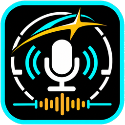
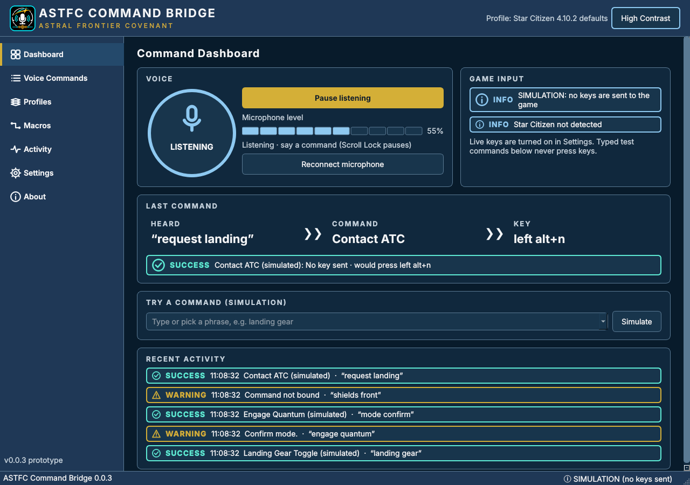

# ASTFC Command Bridge — downloads

*Formerly ASTFC Voice Protocol (0.0.1–0.0.2).*

Voice command for Star Citizen: offline voice commands, by the **Astral Frontier Covenant** (ASTFC).

**[⬇ Download the installer for the latest version](https://github.com/Orguss88/ASTFC-Command-Bridge/releases/latest/download/ASTFC-Command-Bridge-Setup.exe)** · [release notes](https://github.com/Orguss88/ASTFC-Command-Bridge/releases/latest)
· Download page: https://orguss88.github.io/ASTFC-Command-Bridge/
· [What you can say (Commands list)](Commands.txt)

> ▲ **Early test build.** Please report what works and what doesn't on the ASTFC Discord.

## Before you start

1. Download **`ASTFC-Command-Bridge-Setup.exe`** and run it (installs for your account, no admin needed).
   Portable option: `ASTFC-Command-Bridge-portable.zip` on the release page; extract the whole folder and run `ASTFC Command Bridge.exe` inside it.
2. Windows may warn that the app is unrecognised (it isn't signed yet): **More info → Run anyway**.
3. The app uses your **Windows default microphone** (Settings › System › Sound; Privacy & security › Microphone).
4. Offline speech needs **English** in Windows: Settings › Time & language › Speech.
5. It starts in **simulation**: nothing is pressed until you turn on **Live keys** in Settings, and keys only go to Star Citizen while its window is in front.

## Accessibility

- Two themes, **ASTFC Standard** and **High Contrast**, both safe for red-green colour blindness (`Ctrl+T`).
- Every status shows an **icon and a word** (✓ SUCCESS, ▲ WARNING, ✕ FAILED), never colour alone.
- Text size 100-150 % (`Ctrl` + `+`/`−`), compact or comfortable layout, full keyboard use.

## About this repository

This repository only holds downloads, release notes and the download page (`index.html`,
published with GitHub Pages). The app's source is kept in a separate private repository.

Releases are published automatically from the source repository when Jeff approves a build
(its "Publish ASTFC Command Bridge" workflow). The `releases/` folder here is a record of past notes.

ASTFC Command Bridge is a fan-made tool, not affiliated with Cloud Imperium Games.
Star Citizen® is a trademark of Cloud Imperium Rights LLC.
